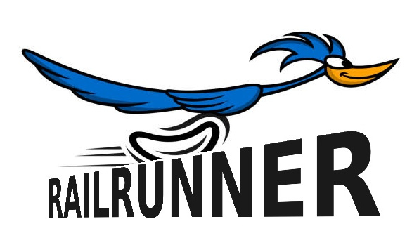

# rail-runner




## Startup

This is kind of finicky!! Sorry :(
When in doubt, power cycle.

With _EVERYTHING_ unplugged (power and data cables):
1. Plug in the linear rail power supply
2. Plug in the Nucleo dev board

```sh
❯ ls /dev/serial/by-id 
usb-STMicroelectronics_STM32_STLink_0670FF3433524B3043072235-if02
```

3. Plug in the Arduino NANO
```
❯ ls /dev/serial/by-id
usb-1a86_USB_Serial-if00-port0
```

4. Initialize the teleop rail
    - Move the platform all the way to the side opposite the motor
    - Power on the power supply (12V, 1.5A)
    - Press the joystick (this "calibrates" the rail position)
    - Check that the rail moves back and forth with movement of the joystick

5. Initialize the teleop rail ros2 node
    - Open the `rail-runner` container: `docker exec -it rail-runner bash -l`
    - Source the ros2 env: `source scripts/ros_env.sh`
    - Launch the teleop node: `launch-rail-teleop` (launches as a background process)
        - Confirm that data is streaming with `ros2 topic echo /rail_velocity`
        - May need to re-enable the teleop rail by pressing the joystick

6. Initialize the drive rail ros2 node
    - Also from the container, launch the drive node: `launch-rail-drive` (launches as a background process)

7. Activate the drive rail using ros2 lifecycle commands

Configure: `ros2 lifecycle set /rail_drive configure`. Should show:

```bash
[INFO] [1792613534.268541747] [rail_drive]: Configuring...
Transitioning successful
```
if not, you are cooked. good luck!

Activate: `ros2 lifecycle set /rail_drive activate`. SHould show:
```bash
[INFO] [1792613547.164035195] [rail_drive]: Activating...
[INFO] [1792613555.093339557] [rail_drive]: Calibrated at 0.0005 m
Transitioning successful
```

There is a 90s timeout and the calibration is slow as hell rn. So just be patient. Also, ignore these warnings:
```
[WARN] [1792613555.144206868] [rail_drive]: Firmware rejected outward motion at the position limit
```
These will go away once you move away from the limit.


If everything worked, congrats! You should be up and running.
    - Check feedback data with `ros2 topic echo /rail_state`

To stop the nodes, run `pkill -9 rail-teleop rail-drive`


## Setup and the `make` system

In general:
- `make clean` removes stale build artifacts
- `make build` compiles a new binary
- `make flash` uploades/flashes the current binary

**From `rail-drive/`**

Targets an STM32 Nucleo F446RE development board
1. `make clean`
    -   equivalent to `rm -rf build`
2. `make build`
    -   builds `rail-drive/build/rail-drive.elf`
3. `make flash`
    -   flashes the binary with openocd 
    -   make sure no other instances of openocd are running

**From `rail-teleop/`**

Targets an Arduino NANO v3
1. `make clean`
    -   equivalent to `rm -rf build`
2. `make build`
    -   builds `rail-teleop/build/rail-teleop.elf`
3. `make flash`
    -   flashes the binary with avrdude

**From `rail-interface/`**

Requires `rail-runner` docker container already built and running
-   `docker start rail-runner` if already built
-   `docker compose build` and `docker compose up -d` to build the container

Targeting the `rail-runner container`:
1.  `make clean`
    - equivalent to `rm -rf build install log`
2.  `make build`
    - equivalent to `colcon build --symlink-install --cmake-args -DCMAKE_EXPORT_COMPILE_COMMANDS=ON`
    - compile commands are optional
